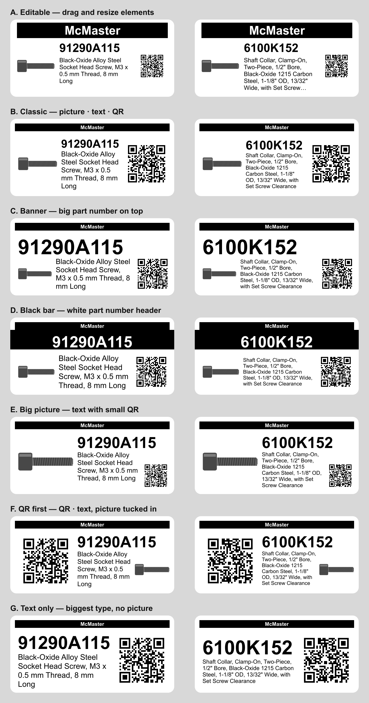

# McMaster → Label

Chrome extension that prints a label for the
McMaster-Carr part you're viewing: part number, description, part picture and
a QR code linking back to `https://www.mcmaster.com/<part number>/`.



## Install
1. `git clone https://github.com/davidnichols/mcmaster2dymo` (or build a zip with `npm run package`).
2. Open `chrome://extensions`, turn on **Developer mode**.
3. **Load unpacked** → select the `extension/` folder.
4. Pin the extension. After pulling changes, click reload on its card.

## Printer support
Choose **Any printer — Chrome print dialog** to print through an installed
Windows printer driver. This supports driver-based thermal label printers
(for example Brother, Zebra, Rollo, or DYMO), and inkjet/laser printers that
can accept the selected paper size. Individual models have not been hardware tested.
Install the manufacturer's driver and configure a paper size matching one
of the three presets below. Select that size in Chrome, use 100% scale,
no margins, and disable headers/footers. The extension creates the requested
copies as separate pages; leave Chrome's copies at 1.

The generic backend needs no DYMO software. Chrome chooses the system printer
in its dialog; the extension cannot enumerate or silently select those printers.
Raw ZPL/EPL, USB-only protocols, tape cutters, and custom media dimensions
require a model-specific integration or additional media configuration.

Direct printing remains available for LabelWriter printers returned by DYMO
Connect (the original target is the 550). LabelManager/tape devices are not
supported by the direct backend. Its XML and printable bounds remain unchanged.
Direct-print errors are reported so you can choose the browser backend;
there is no automatic retry that could duplicate an already submitted job.

## DYMO setup
The LabelWriter 550 needs **DYMO Connect for Desktop** running; the extension
prints through its local web service. The first time, open
https://127.0.0.1:41951/DYMO/DLS/Printing/StatusConnected in Chrome and accept
the certificate (it should say `true`). Then the popup lists your DYMO printers.

Without DYMO Connect the extension falls back to Chrome's print dialog: pick
the LabelWriter, set the paper size to your label and Margins to None.

## Use
On a part page (e.g. `mcmaster.com/9541K43`), click the icon or press
**Alt+Shift+L**. Check the preview, edit the description if needed, choose
label size, layout and printer, and click **Print label**. Settings are
remembered.

- **Label sizes:** 30336 (1" × 2-1/8", default), 30252 Address, 30256 Shipping.
- **Layouts:** Classic, Banner, Black bar, Big picture, QR first, Text only.
- **Picture:** the product render at the top of the page; dimension drawings
  are skipped. Use ◀ ▶ under **Picture** to pick another, or untick it.

## Development
```sh
npm install          # canvas, jsqr, playwright-core (dev only)
npm test             # layout/QR tests + page-extractor test in headless Chrome
npm run layouts      # regenerate docs/30336-layouts.png (or: npm run layouts -- 30252)
npm run package      # dist/mcmaster2dymo-<version>.zip
```
The extractor test needs Chrome or Chromium; set `CHROME_PATH` if it isn't
found automatically.

QR codes: [qrcode-generator](https://github.com/kazuhikoarase/qrcode-generator)
by Kazuhiko Arase (MIT), vendored at `extension/lib/qrcode.js`.

## License

[MIT](LICENSE) © 2026 David Nichols

## AutomationDirect

Open an AutomationDirect product detail page and click the extension, just like McMaster-Carr. The popup automatically reads the open page and waits up to 15 seconds for its attribute table. No part number or URL entry is required. An optional collapsed lookup section accepts McMaster-Carr and AutomationDirect product URLs. The input starts empty; AutomationDirect part numbers are also accepted. Lookup temporarily opens a background tab while the live product attribute table loads (up to 25 seconds). Keep the popup open during lookup. Select attributes to replace the description in both preview and printing. Defaults select up to three identifying attributes; selections, including none, are remembered locally for the last 50 products. The editable description remains available for McMaster. Long label text shrinks and then ends with an ellipsis: review the preview or choose fewer attributes/a larger label.

Verified against the rendered C0-00DD1-D (28 attributes) and C0-02DD1-D (43 attributes) product tables on October 16, 2026. Website changes, unavailable products, network restrictions, or access challenges can prevent lookup; these produce an error instead of inventing specifications. No physical printer verification was performed for this integration.

## Customize labels

Click **Customize — drag and resize** to use the editable layout. Drag the company banner, part number, description, picture, or QR code within the preview. Select an element and move its Size slider to enlarge or shrink it. Arrangements are saved locally per label size; Reset arrangement restores the defaults. The blue selection outline is only a preview guide and does not print. Overlap warnings help you check the design; verify QR readability after resizing. Preset layouts remain available in the Layout menu.
